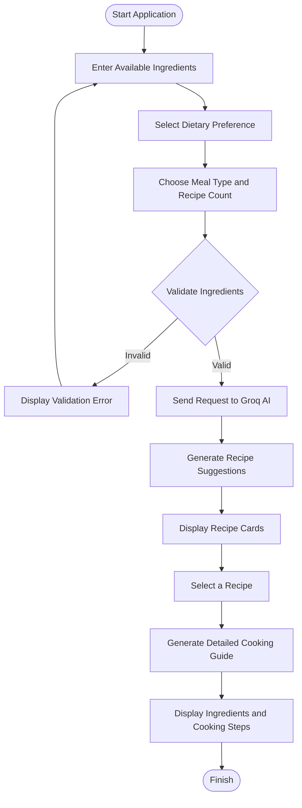

# 🍲 AI Recipe Maker

### Your Personal AI Sous-Chef

AI Recipe Maker is an AI-powered recipe recommendation web application built with Python and Streamlit. It helps users discover practical recipes based on the ingredients they already have at home.

Powered by Groq's AI inference API and LangChain, the application generates personalized recipe suggestions, analyzes ingredient availability, and provides detailed, step-by-step cooking instructions.

The goal is simple: **Make cooking easier, reduce food waste, and turn everyday ingredients into delicious meals.**

---

## 📌 Table of Contents

- [Project Overview](#-project-overview)
- [Key Features](#-key-features)
- [Application Workflow](#-application-workflow)
- [Technology Stack](#-technology-stack)
- [Project Structure](#-project-structure)
- [Installation and Setup](#-installation-and-setup)
- [Environment Configuration](#-environment-configuration)
- [How to Run](#-how-to-run)
- [How to Use](#-how-to-use)
- [AI Recipe Generation](#-ai-recipe-generation)
- [Error Handling and Validation](#-error-handling-and-validation)
- [Future Enhancements](#-future-enhancements)
- [Author](#-author)

---

## 📖 Project Overview

AI Recipe Maker addresses a common problem in everyday cooking: deciding what to prepare with the ingredients available in your kitchen.

Users can enter their available ingredients, choose their dietary preferences, select a meal type, and specify how many recipe ideas they want.

The application uses an AI model to generate suitable recipes and provides information such as preparation time, cooking time, servings, difficulty level, and ingredient availability.

Users can then select a recipe to receive a detailed cooking guide with ingredient quantities, cooking instructions, approximate timings, heat levels, and practical cooking tips.

### Project Objectives

- Recommend recipes using ingredients available at home.
- Reduce unnecessary grocery purchases and food waste.
- Provide personalized recipe suggestions based on dietary preferences.
- Simplify cooking with beginner-friendly instructions.
- Deliver a clean, interactive, and user-friendly web experience.

---

## ✨ Key Features

### 1. Smart Ingredient Management

- Enter ingredients using commas, semicolons, or separate lines.
- Automatically remove duplicate ingredients.
- Add common ingredients using quick-add buttons.
- Validate ingredient inputs before generating recipes.
- Support up to 60 unique ingredients per request.

### 2. AI-Powered Recipe Recommendations

Generate personalized recipe suggestions using the ingredients available in your kitchen.

The application supports multiple dietary preferences:

- Any — Vegetarian and non-vegetarian
- Vegetarian
- Vegan
- Egg-based
- Non-vegetarian

Users can also select a meal category:

- Breakfast
- Lunch
- Dinner
- Snack
- Dessert
- Any meal

Choose between 4 and 12 recipe suggestions per request.

### 3. Ingredient Availability Analysis

Each recipe displays:

- Ingredients available in your kitchen.
- Basic pantry ingredients, such as salt and cooking oil.
- Additional ingredients required, if any.
- An explanation of why the recipe matches your ingredient list.

Recipes that can be prepared without additional ingredients are clearly identified.

### 4. Step-by-Step Cooking Guide

Select a recipe to generate a detailed cooking guide containing:

- Ingredient quantities and preparation notes.
- Numbered cooking instructions.
- Approximate time required for each step.
- Recommended heat levels.
- Practical cooking tips.
- Serving suggestions.
- Basic doneness and food-safety checks where relevant.

### 5. Interactive User Interface

The application includes:

- A responsive Streamlit interface.
- A clean, modern design with a cooking-inspired theme.
- Quick-add ingredient buttons.
- Interactive recipe cards.
- Dynamic recipe selection and navigation.
- Session-state management to preserve results during interaction.

### 6. Reliable AI Response Handling

The application includes JSON response parsing, input validation, API error handling, and safeguards for unexpected AI responses.

---

## 🔄 Application Workflow



---

## 🛠 Technology Stack

| Technology | Purpose |
|---|---|
| Python | Core application development and business logic |
| Streamlit | Interactive web application and user interface |
| Groq API | AI inference and recipe generation |
| LangChain | AI model integration and message handling |
| OpenAI Python SDK | API error handling and compatibility |
| JSON | Structured AI responses and data validation |
| Python-dotenv alternative | Local environment variable loading |

### AI Model

The application uses the following model identifier:

`openai/gpt-oss-20b`

The model is accessed through Groq's OpenAI-compatible API endpoint using LangChain's `ChatOpenAI` integration.

---

## 📂 Project Structure

The following structure represents the main application file and the supporting configuration files.

```text
AI-Recipe-Maker/
│
├── ai_recipe_maker_streamlit.py
│
├── requirements.txt
│
├── .env.example
│
├── .gitignore
│
├── README.md
│
└── .streamlit/
    └── secrets.toml
```

**File descriptions:**

| File | Description |
|---|---|
| `ai_recipe_maker_streamlit.py` | Main Streamlit application containing recipe generation, ingredient validation, and cooking guide logic |
| `requirements.txt` | Python dependencies required to run the application |
| `.env.example` | Example configuration file showing the required environment variable |
| `.gitignore` | Excludes sensitive files and unnecessary development artifacts |
| `.streamlit/secrets.toml` | Optional configuration file for Streamlit secrets |

The configuration files are supporting files to create alongside the uploaded Python application.

---

## ⚙️ Installation and Setup

### Prerequisites

Make sure you have the following installed:

- Python 3.10 or later
- pip
- A Groq API key

### Step 1: Clone the Repository

```bash
git clone <YOUR_REPOSITORY_URL>
```

Navigate to the project directory:

```bash
cd AI-Recipe-Maker
```

### Step 2: Create a Virtual Environment

```bash
python -m venv venv
```

Activate the environment.

**Windows:**

```bash
venv\Scripts\activate
```

**macOS / Linux:**

```bash
source venv/bin/activate
```

### Step 3: Install Dependencies

Create a `requirements.txt` file with the following dependencies:

```text
streamlit
langchain-core
langchain-openai
openai
```

Install the required packages:

```bash
pip install -r requirements.txt
```

---

## 🔑 Environment Configuration

The application requires a Groq API key to generate recipes and cooking instructions.

### Step 1: Obtain an API Key

Create an account on the Groq developer platform and generate an API key.

[Groq Console](https://console.groq.com/)

### Step 2: Configure the API Key

Create a `.env` file in the project root directory.

```env
GROQ_API_KEY=your_groq_api_key_here
```

The application automatically loads the `.env` file when it starts.

Alternatively, you can configure the key using Streamlit secrets.

Create `.streamlit/secrets.toml`:

```toml
GROQ_API_KEY = "your_groq_api_key_here"
```

The application checks for the API key in environment variables and Streamlit secrets.

**Security Best Practices**

- Never upload your actual API key to GitHub.
- Add `.env` and `.streamlit/secrets.toml` to your `.gitignore` file.
- Use Streamlit Community Cloud secrets when deploying the application.
- Do not share your API key publicly.

---

## 🚀 How to Run

After installing the dependencies and configuring your API key, run the following command:

```bash
streamlit run ai_recipe_maker_streamlit.py
```

The application will start locally and display a URL in your terminal.

Open the local URL provided by Streamlit in your browser to access the AI Recipe Maker application.

---

## 🍳 How to Use

### Step 1: Add Ingredients

Enter the ingredients available in your kitchen.

For example:

```text
Tomato, Onion, Potato, Rice, Eggs, Green Chilli
```

You can also use the quick-add buttons to include common ingredients.

### Step 2: Select Your Preferences

Choose your dietary preference and the type of meal you want to prepare.

For example:

```text
Dietary Preference: Vegetarian
Meal Type: Dinner
Recipe Ideas: 8
```

### Step 3: Generate Recipe Suggestions

Click **Find recipes for my kitchen**.

The application validates your ingredients and sends the request to the AI model.

### Step 4: Explore Recipe Results

Review the generated recipe cards, including:

- Recipe descriptions
- Preparation and cooking times
- Serving information
- Difficulty levels
- Ingredient availability
- Additional ingredients required

### Step 5: Generate Cooking Instructions

Select **View cooking steps** for your preferred recipe.

Click **Generate detailed cooking instructions** to receive the complete cooking guide.

Follow the instructions to prepare your selected dish.

---

## 🤖 AI Recipe Generation

The application uses two AI-powered operations.

### Recipe Recommendation

The recipe generation process sends the following information to the AI model:

- Available ingredients
- Dietary preference
- Meal type
- Maximum number of recipes requested

The AI generates structured recipe suggestions in JSON format.

The application then validates the response and displays the recipes as interactive cards.

### Cooking Guide Generation

When a user selects a recipe, the application sends the selected recipe and available ingredients to the AI model.

The model generates a detailed cooking guide containing ingredients, quantities, numbered steps, cooking times, heat levels, and additional tips.

This guide is validated before being displayed to the user.

### Ingredient Matching Logic

The application instructs the AI to prioritize recipes that use only the ingredients provided by the user.

Basic pantry ingredients may be assumed, but they must be identified separately.

If a recipe requires additional ingredients, those ingredients are displayed separately so users can make an informed decision.

---

## 🛡 Error Handling and Validation

The application includes several input and response validation mechanisms.

| Validation | Description |
|---|---|
| Empty input | Requires at least one valid ingredient |
| Ingredient length | Limits the raw ingredient input to 3,000 characters |
| Ingredient count | Allows a maximum of 60 unique ingredients |
| Duplicate ingredients | Removes duplicate entries |
| API key validation | Checks that a valid-looking Groq API key is configured |
| Rate-limit handling | Displays a user-friendly message when the AI service is rate limited |
| API error handling | Handles API failures and unexpected responses |
| JSON validation | Validates the structure of AI-generated responses |
| Recipe validation | Filters invalid recipe entries |
| Cooking guide validation | Ensures that valid cooking instructions are returned |

---

## 🔮 Future Enhancements

Potential improvements for future versions include:

- Save favorite recipes for future reference.
- Add recipe search and filtering options.
- Include nutritional information and calorie estimates.
- Generate shopping lists for missing ingredients.
- Add recipe images and preparation videos.
- Support regional cuisines and customizable cooking styles.
- Add user accounts and personalized recipe history.
- Introduce recipe rating and feedback functionality.
- Add unit conversion and serving-size adjustments.

---

## 👨‍💻 Author

**Rajkumar**

Aspiring Data Analyst | Python | SQL | Power BI | Data Analytics

GitHub: [Rajkumar200409](https://github.com/Rajkumar200409)

---

## 📄 License

This project is intended for educational and personal use.

A formal open-source license can be added to the repository to define permissions for redistribution, modification, and commercial use.

---

### ⚠️ Disclaimer

AI-generated recipes are suggestions and may contain inaccurate ingredient quantities or cooking instructions.

Always verify ingredient freshness, check for allergies, and follow appropriate food-safety practices before preparing or consuming any recipe.

